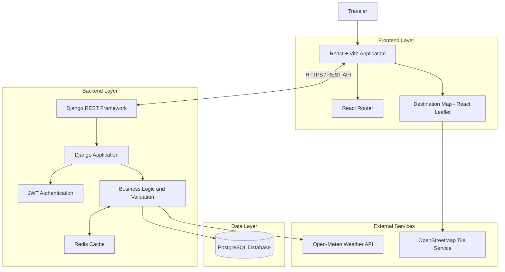

# Tripwise — Full-Stack Travel Planning Application

Tripwise is a full-stack travel-planning application designed to help travellers discover destinations, organize trips, manage itineraries and budgets, and access destination-specific weather information.

The platform provides an integrated travel-planning experience, allowing users to explore available destinations, save places they are interested in, create trips, organize activities, and keep track of travel expenses from one application.

Built with **React, Django REST Framework, and PostgreSQL**, Tripwise focuses on practical full-stack engineering principles, including secure authentication, user-scoped data access, API design, data validation, caching, automated testing, and production deployment.

The application is deployed with a separately hosted frontend and backend, demonstrating a decoupled client-server architecture.

---

## 🌟 Key Features

### 1. Authentication and Authorization

- **User Registration:** Allows users to create accounts.
- **Secure Authentication:** Implements JWT-based authentication with access and refresh tokens.
- **Protected Endpoints:** Restricts access to authenticated users.
- **User-Scoped Resources:** Ensures users can only access and manage their own trips and related records.
- **Resource Ownership Enforcement:** Implements authorization checks at the backend level rather than relying exclusively on frontend restrictions.

### 2. Trip Management

- **Trip Creation:** Create trips associated with selected destinations.
- **Trip Dashboard:** Retrieve and view personal trips.
- **Trip Details:** Access individual trip information.
- **Trip Updates:** Modify existing trip information.
- **Trip Deletion:** Remove trips.
- **Date Validation:** Validate trip dates to prevent invalid date ranges.
- **Ownership Enforcement:** Restrict trip operations to their respective owners.

### 3. Itinerary Management

- Create itinerary items associated with individual trips.
- Retrieve itinerary details.
- Update existing activities.
- Delete itinerary items.
- Organize activities as part of a trip.
- Validate itinerary data and enforce resource ownership.

### 4. Budget Management

- Create budget items for individual trips.
- Retrieve trip-related expenses.
- Update budget records.
- Delete budget items.
- Validate budget information.
- Enforce ownership and database constraints on related resources.

### 5. Destination Discovery

- Browse available travel destinations.
- Search destinations.
- Filter destinations by type.
- View destination information.
- Save destinations for future reference.
- Remove previously saved destinations.
- Display destination locations using geographic coordinates.

### 6. Interactive Destination Map

- Interactive map powered by Leaflet and React Leaflet.
- Displays destinations using geographic markers.
- Provides destination details through marker popups.
- Automatically adjusts the map viewport to accommodate displayed destinations.
- Updates displayed markers according to the destinations returned by the search and filtering functionality.
- Handles destinations with missing or invalid coordinates without attempting to render invalid markers.
- Uses OpenStreetMap tiles for map visualization.

### 7. Weather Integration

- Retrieves destination weather information through the Open-Meteo API.
- Uses destination latitude and longitude for location-specific weather requests.
- Displays current weather conditions.
- Provides a seven-day weather forecast.
- Integrates external weather information into the destination discovery experience.

---

## 🏗️ Architecture Overview

Tripwise follows a decoupled client-server architecture. The React frontend communicates with a Django REST Framework backend through HTTP REST APIs.

The backend handles authentication, business logic, data validation, resource ownership, database operations, and external weather API integration.

PostgreSQL provides persistent storage, while Redis is used for caching selected responses.

### System Architecture



### Architecture Responsibilities

| Component | Responsibility |
|---|---|
| React + Vite | User interface and frontend application |
| React Router | Client-side navigation |
| Django | Backend application and business logic |
| Django REST Framework | REST API development |
| JWT | Authentication and protected API access |
| PostgreSQL | Persistent application data |
| Redis | Response caching |
| Open-Meteo | External weather information |
| React Leaflet | Interactive destination map |
| OpenStreetMap | Map tile data |

---

## 🛠️ Technology Stack

| Layer | Technologies |
|---|---|
| **Frontend** | React, JavaScript, Vite |
| **Frontend Routing** | React Router |
| **Maps** | Leaflet, React Leaflet, OpenStreetMap |
| **Backend** | Python, Django, Django REST Framework |
| **Authentication** | JWT access and refresh tokens |
| **Database** | PostgreSQL |
| **Caching** | Redis |
| **External API Integration** | Open-Meteo Weather API |
| **Production Application Server** | Gunicorn |
| **Frontend Hosting** | Vercel |
| **Backend Hosting** | Render |
| **Database Hosting** | Render PostgreSQL |
| **Testing** | Django automated tests, ESLint, Vite production build |
| **CI/CD** | GitHub Actions |
| **Version Control** | Git and GitHub |

---

## 🧠 Engineering Decisions and Implementation

One of the main objectives of Tripwise was to build a functional application while making deliberate engineering decisions around architecture, data management, security, and deployment.

### 1. Choosing React and Vite for the Frontend

The frontend was built using React and Vite.

React provides a component-based approach to building the user interface, while Vite provides the development server and production build tooling.

React Router handles client-side navigation.

**Why this approach?**

The application primarily requires an interactive user interface that communicates with a separate backend API. A React frontend provides a straightforward way to build and maintain that experience without coupling frontend rendering to the Django application.

### 2. Choosing Django REST Framework for the Backend

Django REST Framework was selected for backend development.

It provides the foundation for implementing REST APIs, serializers, request validation, authentication, permissions, and database-backed application functionality.

**Why this approach?**

Django provides a mature backend framework with an integrated ORM, authentication capabilities, database migrations, and a structured application architecture.

Using Django REST Framework also creates a clear separation between frontend presentation and backend business logic.

### 3. PostgreSQL for Persistent Data Storage

PostgreSQL was selected as the primary relational database.

It stores application data, including:

- User-related information.
- Destinations.
- Trips.
- Itinerary items.
- Budget items.
- Saved destinations.

**Why this approach?**

Tripwise has several related data entities. A relational database provides structured relationships, constraints, and transactional data management.

Django's ORM was used to interact with the database, while migrations provide a reproducible way to manage database schema changes and initial destination data.

### 4. JWT Authentication and Resource Ownership

JWT access and refresh tokens were implemented for authentication.

Protected API endpoints enforce authentication and ownership restrictions.

**Why this approach?**

Authentication alone is not sufficient for applications containing user-specific resources.

A user should not be able to access another user's trips simply because they know a resource identifier.

For this reason, ownership checks are enforced by the backend when retrieving and modifying protected resources.

### 5. Redis Caching with the Cache-Aside Pattern

Redis was introduced to cache selected application responses.

The implementation uses a cache-aside approach:

1. The application checks Redis for an existing cached response.
2. If the response exists, it is returned from the cache.
3. If the response is missing, the application retrieves the data from its underlying source.
4. The result is stored in Redis for subsequent requests.
5. Cached entries expire according to their configured time-to-live.

The implementation uses SHA-256-based cache keys and a 600-second TTL.

Cache reads and writes are handled on a best-effort basis so that Redis availability does not unnecessarily prevent the application from serving requests.

**Why this approach?**

Repeatedly retrieving the same data from an external source or performing the same expensive operation can introduce unnecessary latency.

Caching helps reduce repeated work and provides an opportunity to improve response times.

The cache-aside pattern also keeps the underlying data source independent of Redis.

### 6. External Weather API Integration

Open-Meteo was integrated to provide destination weather information.

The application uses geographic coordinates associated with destinations to request weather data.

**Why this approach?**

Weather is an important part of travel planning. Rather than maintaining a separate weather database, Tripwise retrieves weather information from an external service when required.

This also demonstrates how a backend application can integrate third-party APIs and expose their functionality through its own application interface.

### 7. Reproducible Destination Data Through Django Migrations

During production deployment, the application initially had an empty destination table.

This meant users could not select destinations when creating trips.

Instead of manually inserting records into the production database, a Django data migration was implemented to seed ten Ugandan destinations.

The migration is located at:

`backend/destinations/migrations/0003_seed_destinations.py`

The seeded destinations include:

1. Kampala
2. Entebbe
3. Jinja
4. Murchison Falls National Park
5. Queen Elizabeth National Park
6. Bwindi Impenetrable National Park
7. Kidepo Valley National Park
8. Lake Bunyonyi
9. Fort Portal
10. Kasese

The destination records include geographic coordinates used by the weather integration and interactive map.

**Why this approach?**

Database migrations make initial data setup reproducible across environments and reduce reliance on manual production database changes.

### 8. Separate Frontend and Backend Deployment

The frontend and backend are deployed independently.

- Frontend: Vercel.
- Backend: Render.
- Database: Render PostgreSQL.

The frontend communicates with the backend using a configurable API base URL.

**Why this approach?**

Separating deployment responsibilities allows the frontend and backend to be developed, configured, and deployed independently.

It also provides a practical foundation for maintaining a decoupled application architecture.

---

## 🚀 Live Application

| Component | Deployment |
|---|---|
| **Frontend** | [Tripwise Web Application](https://tripwise-tendo-calvin-s-projects.vercel.app/) |
| **Backend** | [Django Backend](https://tripwise-django-web-app.onrender.com/) |
| **Source Code** | [GitHub Repository](https://github.com/tendocalvin1/tripwise) |

---

## 🧪 Testing and Quality Assurance

Testing and quality checks were incorporated throughout development to verify application functionality and reduce regressions.

### Backend Testing

The Django backend includes automated tests covering application functionality.

The last reported backend test run passed **45 tests**.

Run the backend test suite using:

```bash
cd backend
python manage.py test
```

### Frontend Quality Checks

ESLint is used to identify frontend code-quality issues.

```bash
cd frontend
npm run lint
```

The Vite production build is also used to verify that the frontend can be compiled for deployment.

```bash
npm run build
```

### Continuous Integration

GitHub Actions is configured to run backend and frontend quality checks.

This provides automated verification of application changes through the project's CI workflow.

### Production Verification

The application was deployed and smoke-tested against its production environment.

The reported verification covered:

- Registration and login.
- Authentication and protected access.
- Dashboard navigation.
- Trip creation, retrieval, updating, and deletion.
- Itinerary management.
- Budget management.
- Destination discovery.
- Weather information.
- Saving and removing destinations.
- Refresh and navigation behaviour.
- Browser console and network checks.

---

## 🚀 Getting Started

### Prerequisites

Ensure you have the following installed:

- Python 3.12 or a compatible project-supported Python version.
- Node.js and npm.
- PostgreSQL.
- Redis, for running the caching functionality locally.
- Git.

### 1. Clone the Repository

```bash
git clone https://github.com/tendocalvin1/tripwise.git

cd tripwise
```

### 2. Backend Setup

Navigate to the backend directory:

```bash
cd backend
```

Create and activate a virtual environment:

```bash
python -m venv venv
```

On Ubuntu/Linux:

```bash
source venv/bin/activate
```

On Windows PowerShell:

```powershell
venv\Scripts\Activate.ps1
```

Install the Python dependencies:

```bash
pip install -r requirements.txt
```

Configure the backend environment variables and PostgreSQL database using the project's existing settings.

Apply database migrations:

```bash
python manage.py migrate
```

Run Django's system checks:

```bash
python manage.py check
```

Start the backend development server:

```bash
python manage.py runserver
```

### 3. Frontend Setup

Open another terminal and navigate to the frontend directory:

```bash
cd frontend
```

Install dependencies:

```bash
npm install
```

Configure the frontend API base URL using:

```text
VITE_API_BASE_URL
```

Run the frontend quality checks:

```bash
npm run lint
npm run build
```

Start the development server:

```bash
npm run dev
```

The frontend will display the local development URL provided by Vite.

### 4. Environment Configuration

The frontend uses:

```text
VITE_API_BASE_URL
```

The backend uses environment-based configuration, including:

```text
SECRET_KEY
DEBUG
ALLOWED_HOSTS
CORS_ALLOWED_ORIGINS
CSRF_TRUSTED_ORIGINS
POSTGRES_DB
POSTGRES_USER
POSTGRES_PASSWORD
POSTGRES_HOST
POSTGRES_PORT
```

Redis connection settings must also be configured according to the project's existing cache configuration.

Use local environment variables for development and configure production variables through the hosting provider.

**Never commit actual credentials, passwords, access tokens, or populated `.env` files to version control.**

---

## 📁 Project Structure

```text
tripwise/
│
├── backend/
│   ├── destinations/
│   │   ├── migrations/
│   │   │   └── 0003_seed_destinations.py
│   │   └── ...
│   │
│   ├── trips/
│   ├── users/
│   ├── tripwise/
│   └── manage.py
│
├── frontend/
│   ├── src/
│   │   ├── components/
│   │   │   └── DestinationMap.jsx
│   │   │
│   │   ├── pages/
│   │   │   └── Destinations.jsx
│   │   │
│   │   └── services/
│   │
│   ├── package.json
│   └── ...
│
├── .github/
│   └── workflows/
│
└── README.md
```

---

## 🔒 Security and Configuration Practices

The application incorporates several security-related practices:

- JWT authentication for protected API access.
- Backend permission and resource ownership checks.
- Environment-based configuration for sensitive settings.
- CORS and CSRF configuration for the deployed frontend and backend.
- Database constraints and application-level data validation.
- Separation of frontend and backend responsibilities.

These practices help ensure that application security and data integrity are enforced beyond the user interface.

---

## 📄 Project Scope

Tripwise was developed as a functional full-stack travel-planning MVP.

The implemented scope focuses on destination discovery, trip management, itinerary organization, budget tracking, weather integration, interactive mapping, authentication, and production deployment.

The project demonstrates practical application of backend development, frontend engineering, database design, external API integration, caching, testing, and deployment.

---

## 👤 Author

**Tendo Calvin**

Software Engineer | Full-Stack Developer | GenAI Engineer

- GitHub: [@tendocalvin1](https://github.com/tendocalvin1)
- Project: [Tripwise](https://github.com/tendocalvin1/tripwise)

